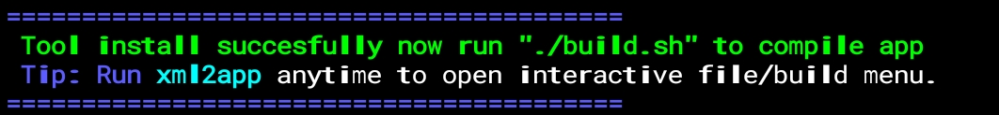
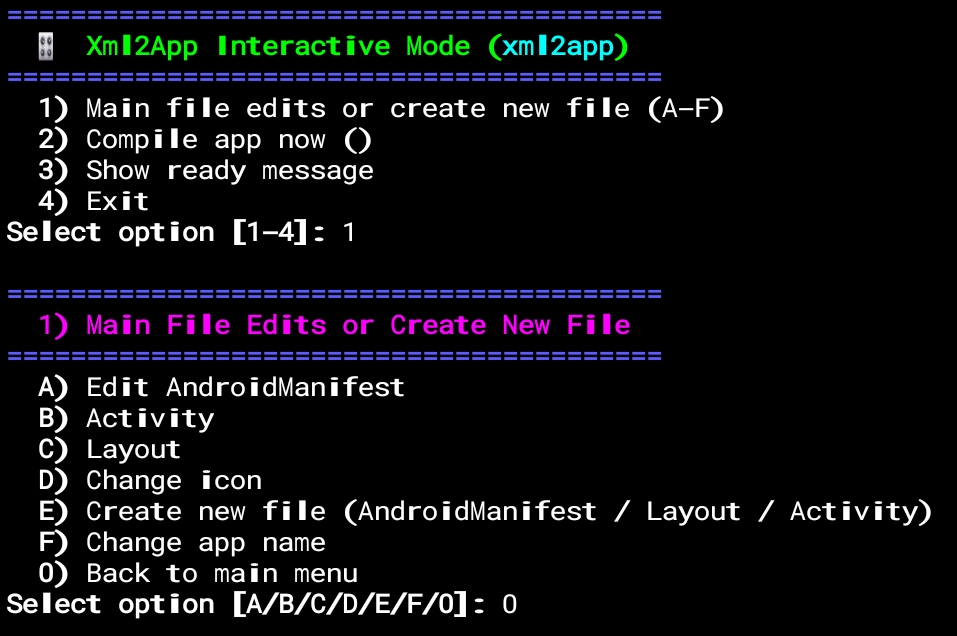
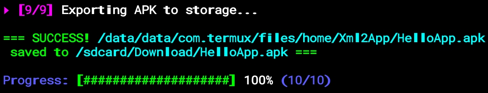
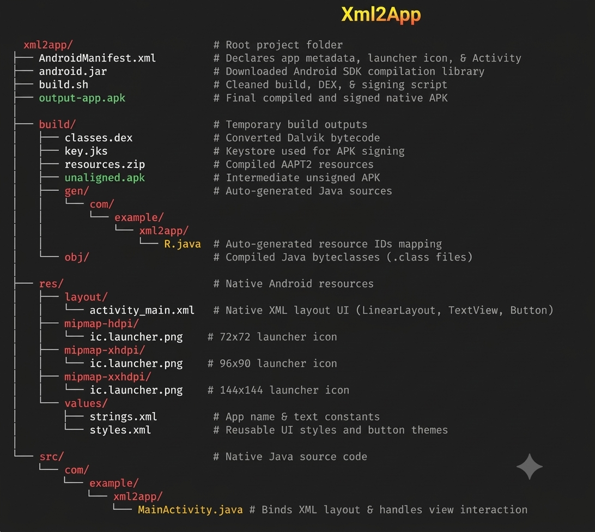

# Xml2App
Create your own native Android apps using Terminal + Android + Any AI — zero Android Studio or Gradle required.

<h2> 🚀 What is Xml2App? </h2>

<ul>

<li> <strong> Xml2App </strong> is a lightweight, CLI-first native Android compilation pipeline built to run directly inside <strong> Termux </strong> on your Android smartphone.</li>
<li>Instead of relying on heavy IDEs, Gradle daemons, or a PC, Xml2App orchestrates native Android SDK command-line tools (` <mark> <i> aapt2 </i> </mark> `, ` <mark> <i> javac </i> </mark> `, ` <mark> <i> d8 </i> </mark> `, ` <mark> <i> zipalign </i> </mark> `, and ` <mark> <i> apksigner </i> </mark> `) via modular Bash scripts to compile raw XML and Java source code into signed, installable ` <mark> <i> <u> .apk </u> </i> </mark> ` files in seconds.

</ul>

<h2> 📸 Preview & Demo </h2>

<h2> 🤖 Using Xml2App with Any AI </h2>
Xml2App is designed as an <mark> AI-native app builder workflow </mark> :
<h3> 1. Describe Your App: </h3> Prompt any AI ( <mark> <i> Gemini </i> </mark> , <mark> <i> ChatGPT </i> </mark> , <mark> <i> Claude </i> </mark> , etc.) to generate a single-script `build.sh` containing your ` <u><strong>AndroidManifest.xml</strong></u>`, <u><strong>XML layouts/resources</strong></u>, and Java `<u><strong>Activity</strong></u>` classes.
<h3> 2. Paste & Execute: </h3> Paste the generated script directly into your ` <mark> ~/Xml2App </mark> ` directory in Termux.
<h3> 3. Instant APK: </h3> Run ` <mark> ./build.sh </mark> ` — the script automatically compiles resources, generates icons, builds DEX bytecode, signs the package, and exports the ready-to-install ` <mark> .apk </mark> ` straight to `<mark> /sdcard/Download/ </mark>`.

<h2> Folder Structure:- </h2>

  

<h2>setup:-</h2>
  
  <table border="3" align="center">
    <tr>
      <th> Clone Repo </th>
      <th> git clone https://github.com/The-Learner-X/Xml2App.git </th>
    </tr>
    <tr>
      <th> Change Directory </th>
      <th> cd Xml2App </th>
    </tr>
    <tr>
      <th> run script </th>
      <th> bash install.sh </th>
    </tr>
  </table>

